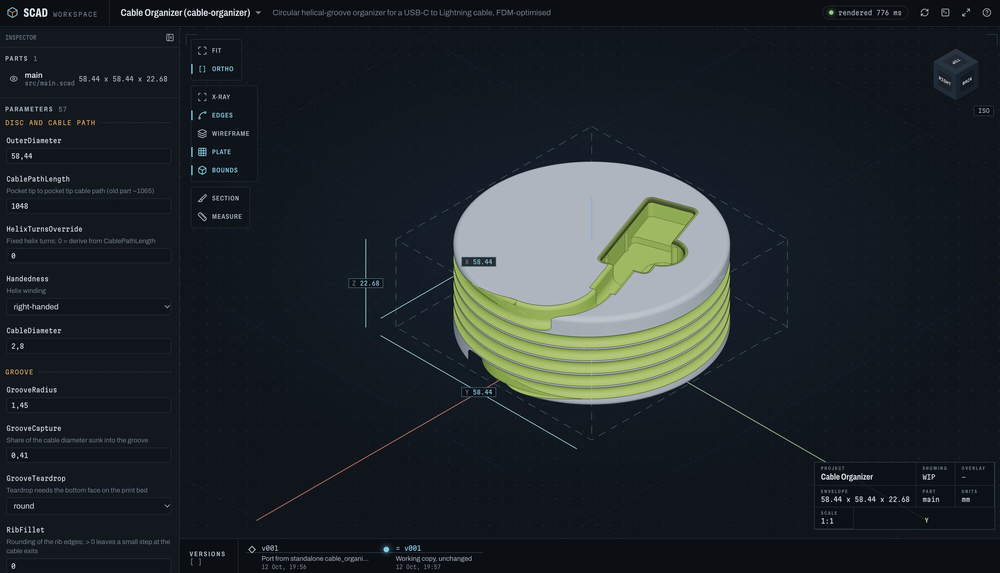
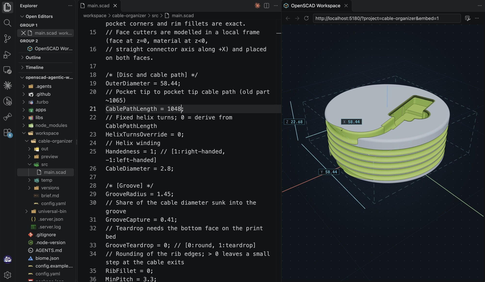
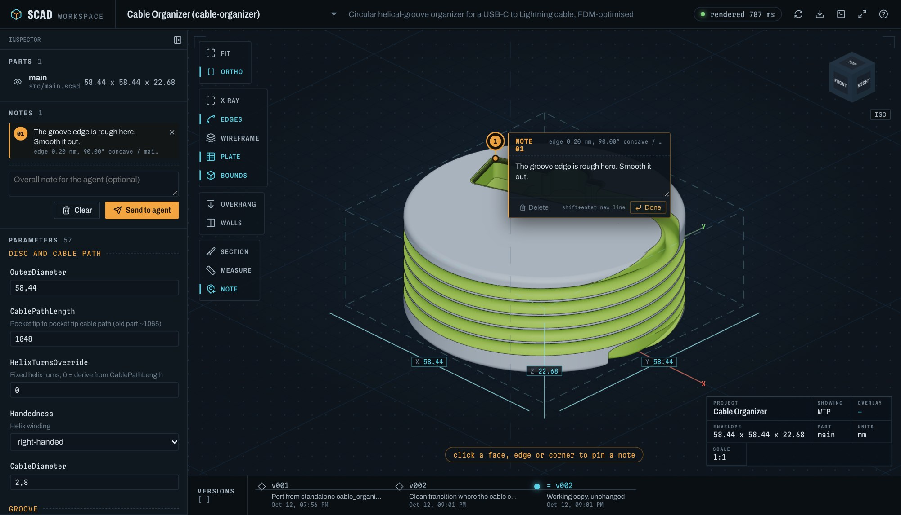

# OpenSCAD Agentic Workspace

A workspace for building parametric 3D models together with a coding agent. The agent writes OpenSCAD, renders through the OpenSCAD CLI and checkpoints every change. A live viewer in your browser shows the model taking shape while the agent works.

> [!WARNING]
> This entire project is vibe coded. I did not write or read any of the code myself. Use it at your own risk.



## Setup

Requirements: Node.js 24+, pnpm (via `corepack enable`), git, and a recent OpenSCAD development snapshot (2024 or newer, for the Manifold backend and colored 3MF).

```bash
corepack enable
pnpm install
pnpm scad doctor
```

`doctor` creates `config.yaml` from `config.example.yaml`, finds OpenSCAD and tells you what is missing. OpenSCAD lookup order:
1. `OPENSCAD_PATH`
2. `openscad.path` in `config.yaml`
3. `PATH`
4. Standard install locations for macOS, Windows and Linux

The first path it finds is saved in `config.yaml`.

Agents pick up `AGENTS.md` and the skills in `.agents/skills/`. If you clone the repo and ask your agent to set it up, it follows `.agents/skills/scad-setup/SKILL.md`.

## How it works


- `pnpm scad open <project>` starts the Vite dev server in the background. If a viewer tab is already open, it switches that tab to the project; otherwise it opens your default browser.
- The dev server watches `src/`, `config.yaml` and shared libraries, and re-renders whenever a file is saved. That includes your own edits in an editor.
- With `?embed=1` the viewer drops its panels and shows only the viewport, which fits next to the source in an editor tab:

  

- The agent inspects its own work from a 2x2 contact sheet (iso, front, right, top) and from section snapshots rendered by OpenSCAD.
- Before checkpointing or exporting, the agent runs `pnpm scad check` (see [Printability check](#printability-check)).
- After every finished request the agent creates a checkpoint (`versions/vNNN`). It contains the sources, the models and the parameter values, so you can go back to any version or compare against it.

## Viewer

- **View cube:** snaps to faces, edges and corners. Keys: 0 iso, 1 front, 2 top, 3 right, 4 back, 5 bottom, 6 left. F fits the model, O toggles ortho/perspective.
- **Section view:** X, Y or Z plane, or a free plane moved with a gizmo. The cut faces are drawn as hatched caps. A separate X-ray mode shows the inside.
- **Display:** edges, wireframe, build plate, and bounding box dimensions in mm. The plate has the active printer's bed size and sits centred under the model, the way a slicer places it. A dashed box shows the build volume, labelled with the printer name. The outline and the dimensions turn red when the model does not fit.
- **Print overlays:** both use the active [printer profile](#printers), follow every re-render, tweak and version, and show a legend with the totals.
  - FDM: an overhang heatmap (H) shades faces past the overhang angle from amber to red and marks faces on the bed.
  - Resin: H marks islands in red instead (see the [Printability check](#printability-check)).
  - A wall-thickness overlay (T) shows walls under the nozzle (resin: minimum feature) in red and under the minimum wall in amber. Wall thickness is measured in a Web Worker.
- **Measuring:** click two points to get distance and dx/dy/dz. Points snap to vertices.
- **Parts panel:** shows each part on its own or the whole assembly.
- **Parameter panel:** lists the OpenSCAD customizer parameters. Changing a value renders a temporary preview. "Send to agent" turns your values into a proposal the agent applies to the source.
- **3D notes:** the Note tool (N) pins a numbered note wherever you click: on a face, an edge or a corner. You can add several, edit or delete them in place or in the Notes panel, and send them together. The agent gets each note's coordinates, normal and part, and what was clicked. That covers snapped edge end points and angle, flat face extent, or a fitted cylinder axis and diameter for holes and bosses. It also gets a snapshot of your view with the numbered pins. Sending again replaces notes the agent has not handled yet. Sent notes stay visible as dashed pins until the agent clears them.

  

- **Version timeline:** open any checkpoint, or overlay one as a ghost to compare.
- **3MF export:** the download button in the top bar runs the same export as `pnpm scad export`, limited to 3MF and the parts shown in the viewer. The files are written to `out/` (listed in `out/export.json`) and downloaded by the browser, one file per part. With tweaked parameters, a menu asks whether to export the source or apply the tweaks. Tweaked files are named `*-tweaked.3mf`, labelled `tweaked` instead of a version, and their values are stored in `export.json`. While an older checkpoint is open, the button downloads that version's stored preview 3MF instead. After every export the [printability check](#printability-check) runs on the exported files, and a toast shows the files with PASS, WARN or FAIL. FAIL does not block the export. Only one export per project runs at a time.
- **Errors and console:** OpenSCAD errors appear on top of the last good model, and the console shows ECHO output and warnings.

Press `?` in the viewer for all keys.

## CLI

`pnpm scad` without arguments prints the reference. The main commands:

| Command | Purpose |
| --- | --- |
| `doctor` | Check the setup, find OpenSCAD |
| `new <project>` | Create `workspace/<project>` with a parametric template |
| `open [project]` / `serve` / `stop` | Viewer and background dev server |
| `render <project>` | Render all parts, then the contact sheet |
| `snapshot <project> --section x=10` | Extra views and cross-sections as PNG |
| `params <project>` | Customizer parameters |
| `printer [project]` | Active printer profile with tolerances, and all defined printers |
| `check <project>` | Printability check against the active printer: manifold, bed fit, thin walls, floating bodies, overhangs (FDM) or islands and trapped resin (resin) |
| `checkpoint <project> -m "..."` / `versions` / `restore <project> v003` | History |
| `proposal <project>` | Parameter values and 3D notes sent from the viewer |
| `export <project>` | Write the configured formats to `out/` |
| `lib new` / `lib add` / `lib sync` | Shared and third-party OpenSCAD libraries |

Every command accepts `--json`.

## Printability check

`pnpm scad check <project>` analyses the rendered 3MF meshes in `preview/` against the project's active [printer profile](#printers). If the sources changed since the last render, it renders first. It prints PASS, WARN or FAIL per part and per check, writes `preview/check.json`, and exits with 1 if anything fails. Checks that do not apply to the process are `null` in `check.json`.

| Check | Process | FAIL | WARN |
| --- | --- | --- | --- |
| manifold | all | open or non-manifold edges, flipped faces, inside-out mesh | edges folding back more than 170° (zero-thickness fins or flaps) |
| bed | all | bounding box does not fit the printer's `bed` | fits only rotated 90° around Z, or the lowest point is not at z = 0 |
| overhangs | fdm | never | regions steeper than `overhangAngle` from vertical, faces on the bed excluded |
| islands | resin | never | points or flat undersides where a layer starts with nothing below it (needs a support) |
| walls | all | thinnest 0.1 mm² patch of a region is under the nozzle (fdm) or `minFeature` (resin) | regions thinner than `minWall` (fdm default 2 × nozzle) |
| bodies | all | never | bodies floating above the bed, bodies smaller than `minWall`; for resin also enclosed voids, which trap resin and need drain holes of at least `drainHole` |

Regions come with area, centre, bounding box and their worst value. Regions smaller than `check.minRegionArea` are dropped. Islands come with their position and height above the bed.

Islands are local minima of the surface: vertices, or flat patches of vertices, with no lower neighbour, above the bed, and with the surrounding faces pointing down. That excludes the floors of enclosed voids and holes. A bridge between two walls is not an island, because each of its layers connects to the walls.

Wall thickness is approximate. From each triangle's centroid, a ray is cast inwards along the inverted normal against a BVH of the mesh. The first face it leaves the solid through counts only if that face points roughly the opposite way (normals more than 120° apart). That means:
- Large triangles are measured at one point.
- Wedges and knife edges count where their faces are close to opposite.
- Gaps and clearances between bodies are not measured.

`checkpoint`, `export` and `status` note when the check is missing, older than the render, or failed. Exports from the viewer check the exported 3MF files directly and store the result as `meshCheck` in `out/export.json`, without touching `preview/check.json`.

## Configuration

`config.yaml` (gitignored) holds the workspace defaults:
- OpenSCAD path, backend and timeout
- Render defines
- Contact sheet settings
- Export formats and file names
- Server port
- Printers and the active print settings (see [Printers](#printers)), and the minimum region area for the check
- Third-party libraries pinned to a git ref

Each project's `workspace/<project>/config.yaml` can override any of these and also declares the project's name, description and parts. Objects are merged key by key; lists and plain values replace the inherited value. See `config.example.yaml` for every key. When an older `config.yaml` lacks a section that `config.example.yaml` has, `pnpm scad doctor` appends it with its comments. `doctor` also validates the root config and every project config and reports each invalid key.

### Printers

Printer profiles drive `pnpm scad check`, the viewer's build plate and overlays, and the clearances the agent designs with. There are two sections:
- `printers` describes the machines you own, by name. `process` decides which keys are valid. A key from the other process is a validation error.
- `print` selects what to design for: `printer`, `nozzle` and `layerHeight`.

```yaml
print:
  printer: x1c
  nozzle: null          # fdm only; one of the printer's nozzles, null = the first
  layerHeight: null     # null = the printer's layerHeight

printers:
  x1c:
    process: fdm
    bed: [256, 256, 256]
    nozzles: [0.4, 0.2, 0.6]
    layerHeight: 0.2
    overhangAngle: 45
    minWall: null       # null = 2 x nozzle
    tolerances: { press: 0.2, sliding: 0.3, loose: 0.45, hole: 0.2 }
  mars:
    process: resin
    bed: [143, 89, 175]
    pixel: 0.035        # XY resolution
    layerHeight: 0.05
    minWall: 0.8
    minFeature: 0.3
    drainHole: 2.5
    tolerances: { press: 0.05, sliding: 0.1, loose: 0.2, hole: 0.1 }
```

Projects use the normal config inheritance:
- `print: { nozzle: 0.6 }` designs one project for another nozzle of the same printer.
- `print: { printer: mars }` switches the project to another printer.
- `printers: { x1c: { overhangAngle: 50 } }` adjusts a single value for one project.

The loaded config is validated as a whole:
- `print.printer` must exist in `printers`.
- `print.nozzle` must be in the printer's `nozzles`, and is rejected for resin printers.
- `minWall` cannot be below the nozzle (fdm) or `minFeature` (resin), and `minFeature` cannot be below one pixel.

Tolerances are per side for mating parts (`press`, `sliding`, `loose`). `hole` is added to the diameter of holes for pins and screws. `pnpm scad printer <project>` prints the resolved profile; the agent reads it before modelling and carries the values into the model's print parameters.

## Workspace layout

```
workspace/                    gitignored
  _libs/<name>/               shared libraries you build, available as use <name/name.scad>
  _vendor/<Name>@<ref>/       third-party checkouts from config.yaml `libraries`
  <project>/
    config.yaml  brief.md
    src/                      OpenSCAD sources (source of truth)
    preview/                  current render: models, render.json, sheet.png, snapshots, check.json
    versions/vNNN/            checkpoints
    proposals/                from the viewer: params.json, annotations.json + annotations.png
    out/                      exports
    temp/                     scratch
```

## Development

The repo is a pnpm workspace orchestrated by Turborepo and linted with Biome:
- `apps/cli`: the `pnpm scad` CLI, one module per command group
- `apps/web`: the React + three.js viewer (reusable components, feature panels, three.js scene, store)
- `libs/protocol`: shared types, constants, events and the typed HTTP client (Node and browser)
- `libs/geometry`: mesh topology, surface and printability analysis (Node and browser)
- `libs/core`: Node-only config, discovery, rendering, versions, libraries, exports, printability check of rendered files
- `libs/vite-plugin-scad`: dev server API, file watcher, live events

Dependencies point one way: `protocol` <- `geometry` <- `core` <- `cli` / `vite-plugin-scad`. The viewer only uses `protocol` and `geometry`. Biome limits `.ts`/`.tsx` files to 500 lines.

```bash
pnpm dev         # viewer only
pnpm typecheck
pnpm test        # OpenSCAD-dependent tests skip when OpenSCAD is not installed
pnpm lint
pnpm build
```

CI (`.github/workflows/ci.yml`) runs lint, typecheck, tests and build.

## Honorable Mentions

Inspired by [iKasch/freecad-py-agent](https://github.com/iKasch/freecad-py-agent/)