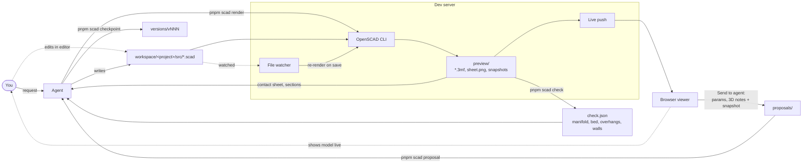

# OpenSCAD Agentic Workspace

A workspace for building parametric 3D models together with a coding agent. The agent writes OpenSCAD, renders through the OpenSCAD CLI and checkpoints every change. A live viewer in your browser shows the model taking shape while the agent works.


## Setup

Requirements: Node.js 24+, pnpm (via `corepack enable`), git, and a recent OpenSCAD development snapshot (2024 or newer, for the Manifold backend and colored 3MF).

```bash
corepack enable
pnpm install
pnpm scad doctor
```

`doctor` creates `config.yaml` from `config.example.yaml`, finds OpenSCAD and tells you what is missing. OpenSCAD lookup order:
1. `OPENSCAD_PATH`
2. `openscad.path` in `config.yaml`
3. `PATH`
4. Standard install locations for macOS, Windows and Linux

The first path it finds is saved in `config.yaml`.

Agents pick up `AGENTS.md` and the skills in `.agents/skills/`. If you clone the repo and ask your agent to set it up, it follows `.agents/skills/scad-setup/SKILL.md`.

## How it works



- `pnpm scad open <project>` starts the Vite dev server in the background. If a viewer tab is already open, it switches that tab to the project; otherwise it opens your default browser.
- The dev server watches `src/`, `config.yaml` and shared libraries, and re-renders whenever a file is saved. That includes your own edits in an editor.
- With `?embed=1` the viewer drops its panels and shows only the viewport, which fits next to the source in an editor tab:

  

- The agent inspects its own work from a 2x2 contact sheet (iso, front, right, top) and from section snapshots rendered by OpenSCAD.
- Before checkpointing or exporting, the agent runs `pnpm scad check` (see [Printability check](#printability-check)).
- After every finished request the agent creates a checkpoint (`versions/vNNN`). It contains the sources, the models and the parameter values, so you can go back to any version or compare against it.

## Viewer

- **View cube:** snaps to faces, edges and corners. Keys: 0 iso, 1 front, 2 top, 3 right, 4 back, 5 bottom, 6 left. F fits the model, O toggles ortho/perspective.
- **Section view:** X, Y or Z plane, or a free plane moved with a gizmo. The cut faces are drawn as hatched caps. A separate X-ray mode shows the inside.
- **Display:** edges, wireframe, build plate grid, and bounding box dimensions in mm.
- **Print overlays:** an overhang heatmap (H) shades faces past the overhang angle from amber to red and marks faces on the bed. A wall-thickness overlay (T) shows walls under the nozzle diameter in red and under the minimum wall in amber. Wall thickness is measured in a Web Worker. Both overlays use the thresholds from `config.yaml`, follow every re-render, tweak and version, and show a legend with the totals.
- **Measuring:** click two points to get distance and dx/dy/dz. Points snap to vertices.
- **Parts panel:** shows each part on its own or the whole assembly.
- **Parameter panel:** lists the OpenSCAD customizer parameters. Changing a value renders a temporary preview. "Send to agent" turns your values into a proposal the agent applies to the source.
- **3D notes:** the Note tool (N) pins a numbered note wherever you click: on a face, an edge or a corner. You can add several, edit or delete them in place or in the Notes panel, and send them together. The agent gets each note's coordinates, normal and part, and what was clicked. That covers snapped edge end points and angle, flat face extent, or a fitted cylinder axis and diameter for holes and bosses. It also gets a snapshot of your view with the numbered pins. Sending again replaces notes the agent has not handled yet. Sent notes stay visible as dashed pins until the agent clears them.

  

- **Version timeline:** open any checkpoint, or overlay one as a ghost to compare.
- **Errors and console:** OpenSCAD errors appear on top of the last good model, and the console shows ECHO output and warnings.

Press `?` in the viewer for all keys.

## CLI

`pnpm scad` without arguments prints the reference. The main commands:

| Command | Purpose |
| --- | --- |
| `doctor` | Check the setup, find OpenSCAD |
| `new <project>` | Create `workspace/<project>` with a parametric template |
| `open [project]` / `serve` / `stop` | Viewer and background dev server |
| `render <project>` | Render all parts, then the contact sheet |
| `snapshot <project> --section x=10` | Extra views and cross-sections as PNG |
| `params <project>` | Customizer parameters |
| `check <project>` | Printability check: manifold, bed fit, overhangs, thin walls, floating bodies |
| `checkpoint <project> -m "..."` / `versions` / `restore <project> v003` | History |
| `proposal <project>` | Parameter values and 3D notes sent from the viewer |
| `export <project>` | Write the configured formats to `out/` |
| `lib new` / `lib add` / `lib sync` | Shared and third-party OpenSCAD libraries |

Every command accepts `--json`.

## Printability check

`pnpm scad check <project>` analyses the rendered 3MF meshes in `preview/`. If the sources changed since the last render, it renders first. It prints PASS, WARN or FAIL per part and per check, writes `preview/check.json`, and exits with 1 if anything fails.

| Check | FAIL | WARN |
| --- | --- | --- |
| manifold | open or non-manifold edges, flipped faces, inside-out mesh | edges folding back more than 170° (zero-thickness fins or flaps) |
| bed | bounding box does not fit `printer.bed` | fits only rotated 90° around Z, or the lowest point is not at z = 0 |
| overhangs | never | regions steeper than `check.overhangAngle` from vertical, faces on the bed excluded |
| walls | thinnest 0.1 mm² patch of a region is under `printer.nozzle` | regions thinner than `check.minWall` (default 2 × nozzle) |
| bodies | never | bodies floating above the bed, bodies smaller than `minWall` |

Regions come with area, centre, bounding box and their worst value. Regions smaller than `check.minRegionArea` are dropped.

Wall thickness is approximate. From each triangle's centroid, a ray is cast inwards along the inverted normal against a BVH of the mesh. The first face it leaves the solid through counts only if that face points roughly the opposite way (normals more than 120° apart). That means:
- Large triangles are measured at one point.
- Wedges and knife edges count where their faces are close to opposite.
- Gaps and clearances between bodies are not measured.

`checkpoint`, `export` and `status` note when the check is missing, older than the render, or failed.

## Configuration

`config.yaml` (gitignored) holds the workspace defaults:
- OpenSCAD path, backend and timeout
- Render defines
- Contact sheet settings
- Export formats and file names
- Server port
- Printer (build volume, nozzle diameter) and check thresholds (overhang angle, minimum wall, minimum region area)
- Third-party libraries pinned to a git ref

Each project's `workspace/<project>/config.yaml` can override any of these and also declares the project's name, description and parts. Objects are merged key by key; lists and plain values replace the inherited value. See `config.example.yaml` for every key. When an older `config.yaml` lacks a section that `config.example.yaml` has, `pnpm scad doctor` appends it with its comments.

## Workspace layout

```
workspace/                    gitignored
  _libs/<name>/               shared libraries you build, available as use <name/name.scad>
  _vendor/<Name>@<ref>/       third-party checkouts from config.yaml `libraries`
  <project>/
    config.yaml  brief.md
    src/                      OpenSCAD sources (source of truth)
    preview/                  current render: models, render.json, sheet.png, snapshots, check.json
    versions/vNNN/            checkpoints
    proposals/                from the viewer: params.json, annotations.json + annotations.png
    out/                      exports
    temp/                     scratch
```

## Development

The repo is a pnpm workspace orchestrated by Turborepo and linted with Biome:
- `apps/cli`: the `pnpm scad` CLI
- `apps/web`: the React + three.js viewer
- `libs/core`: config, discovery, rendering, versions, libraries, exports, printability check
- `libs/vite-plugin-scad`: dev server API, file watcher, live events

```bash
pnpm dev         # viewer only
pnpm typecheck
pnpm test        # OpenSCAD-dependent tests skip when OpenSCAD is not installed
pnpm lint
pnpm build
```

CI (`.github/workflows/ci.yml`) runs lint, typecheck, tests and build.

## Honorable Mentions

Inspired by [iKasch/freecad-py-agent](https://github.com/iKasch/freecad-py-agent/)